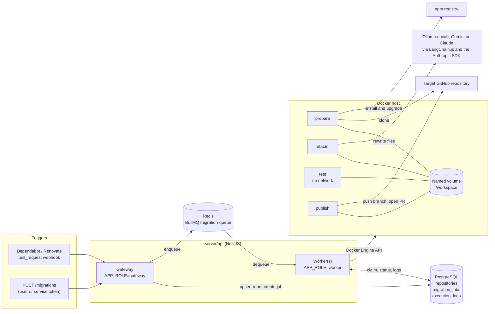
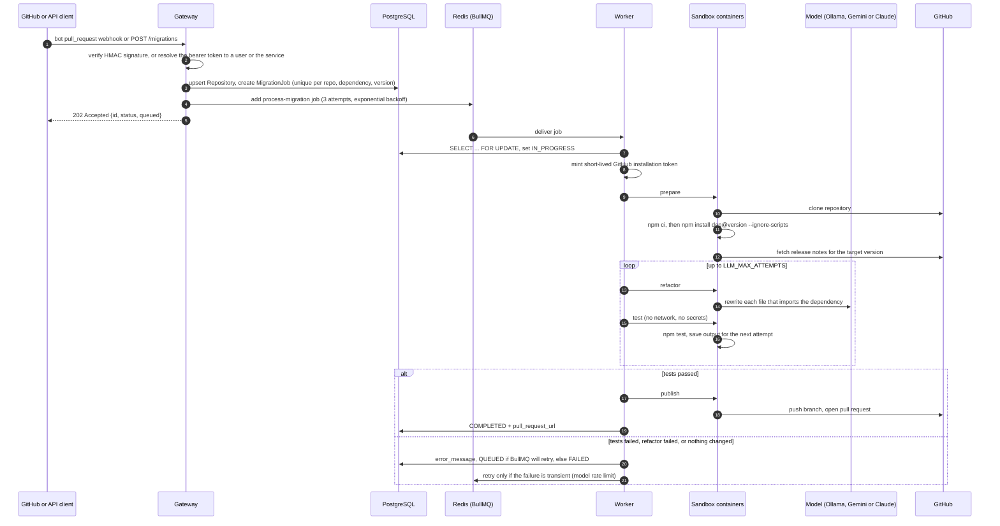
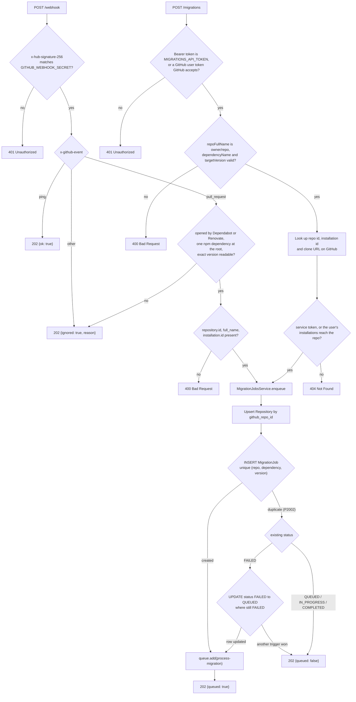
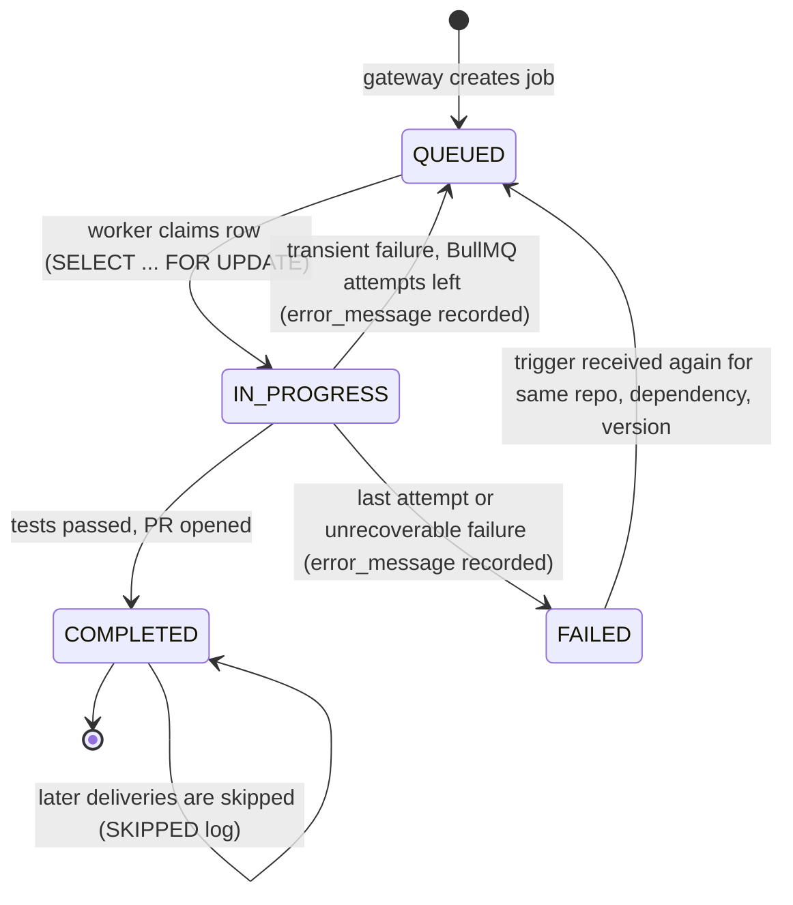
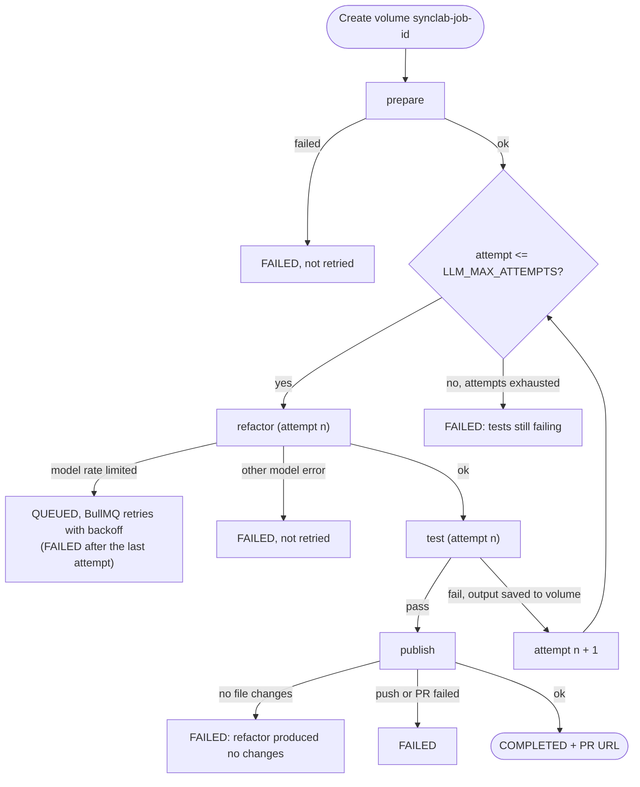
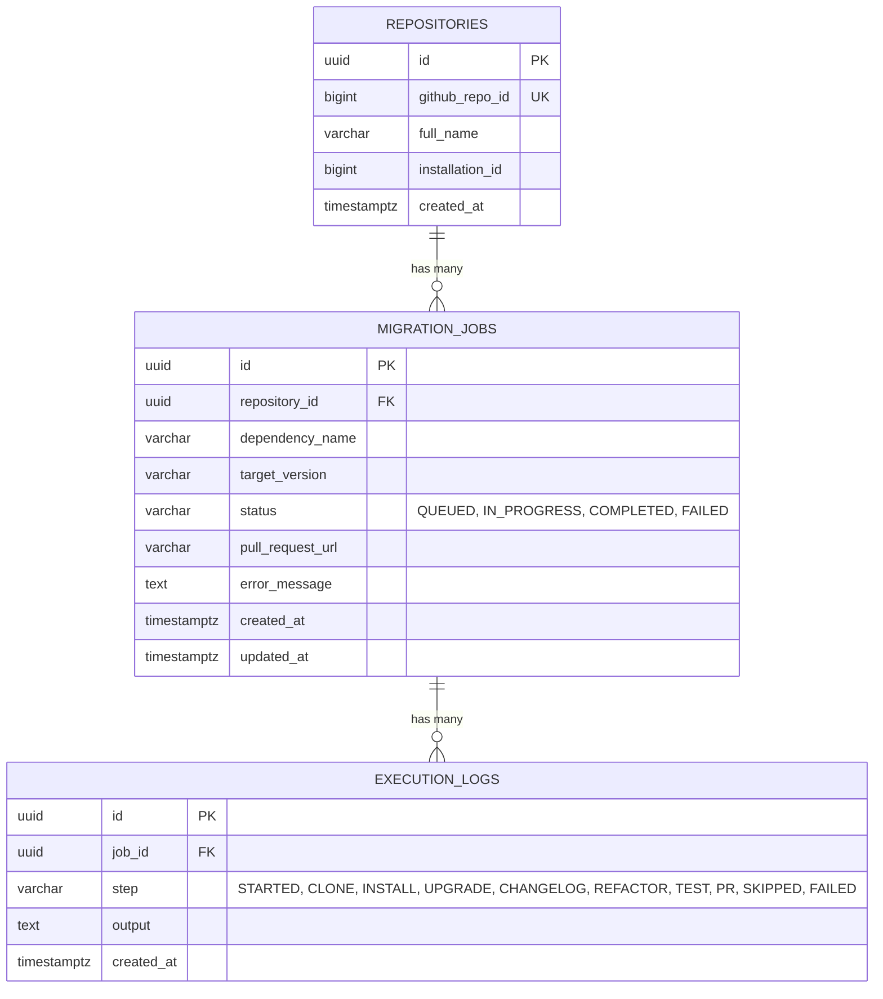

# SyncLab

SyncLab is an autonomous API migration agent.
When a dependency ships a breaking release, SyncLab clones the affected repository, upgrades the dependency, rewrites the code that uses it with an LLM, proves the change with the repository's own test suite, and opens a pull request.

The untrusted repository code never runs on the orchestrating server.
Every step that touches it runs in a short-lived, locked-down Docker container, and the only container that executes repository code has no network and no credentials.

A web dashboard in `web/` shows every migration job, its progress through the pipeline, and its execution log.

- [How it works in one minute](#how-it-works-in-one-minute)
- [High-level workflow](#high-level-workflow)
- [Low-level workflow](#low-level-workflow)
- [Dashboard](#dashboard)
- [Data model](#data-model)
- [Failure handling and retries](#failure-handling-and-retries)
- [Repository layout](#repository-layout)
- [Getting started](#getting-started)
- [Testing and benchmarks](#testing-and-benchmarks)
- [Current limitations and roadmap](#current-limitations-and-roadmap)

## How it works in one minute

1. A trigger arrives: a signed `pull_request` webhook for a Dependabot or Renovate npm update, or an authenticated `POST /migrations` request.
2. The **gateway** records a `MigrationJob` in PostgreSQL and enqueues it on a BullMQ queue in Redis.
3. A **worker** claims the job and runs the **sandbox** image as a sequence of containers over one shared Docker volume:
   `prepare` (clone, install, upgrade the dependency, fetch release notes), then `refactor` and `test` in a loop, then `publish`.
4. If the tests pass, `publish` pushes a branch and opens a pull request, and the job is marked `COMPLETED` with the PR URL.

## High-level workflow

### System architecture



The gateway and worker are the same NestJS application started in different roles.
`APP_ROLE=all` (the default) runs both in one process.
Running one gateway and several `APP_ROLE=worker` processes lets jobs run in parallel, because every worker pulls from the same Redis queue.

### End-to-end sequence



## Low-level workflow

### 1. Gateway intake

Code: `server/api/src/gateway/`.



Key details:

- Signatures are checked over the raw request body with a constant-time comparison, so a forged or re-serialized payload is rejected.
- Deduplication relies on the database unique constraint rather than read-then-write, so two concurrent deliveries of the same update cannot both create a job.
- The webhook reads the dependency and exact version from the bot's pull request title (Renovate's shortened `to v5` from the change table in its body), and ignores grouped updates, other ecosystems, subdirectories, forks and anything not authored by the bot account.
  See [`server/api/README.md`](server/api/README.md#automatic-trigger-dependabot-and-renovate-pull-requests).
- A user's bearer token is resolved through GitHub to the repositories their installations reach, and every read and write is limited to those repositories by GitHub repository id.
- A redelivered webhook never opens a second pull request, but a job that previously `FAILED` is queued again.
  The conditional `FAILED` to `QUEUED` update is the claim on that retry, so concurrent triggers queue it only once.
- Both triggers share `MigrationJobsService`, so they deduplicate and retry identically.

### 2. Worker job lifecycle

Code: `server/api/src/worker/migration.processor.ts` and `claim-job.ts`.



For each job the worker:

1. Locks the `migration_jobs` row in a transaction.
   If the job is already `COMPLETED`, it writes a `SKIPPED` log and stops; otherwise it sets `IN_PROGRESS`.
2. Mints a GitHub App installation token (or falls back to `GITHUB_TOKEN` for local development).
   The App private key never leaves the worker.
3. With a hosted `LLM_PROVIDER`, refuses to start without its key (`GEMINI_API_KEY` or `ANTHROPIC_API_KEY`, unrecoverable).
4. Checks the sandbox image exists locally, creates a named volume `synclab-job-<jobId>`, and runs the phases below.
5. Appends every phase's step logs to `execution_logs`, then removes every container and the volume, whatever the outcome.

### 3. Sandbox phase loop

Code: `server/api/src/worker/sandbox/docker-sandbox.service.ts` (orchestration) and `server/sandbox/src/phases/` (what runs inside each container).



Each phase is a fresh container from the same `synclab-sandbox` image, started with the phase name as its command.
State passes between phases only through the shared `/workspace` volume: the repository checkout in `/workspace/repo` and small state files in `/workspace/state` (release notes and the last test output).

#### Phase isolation

| Phase | Network | GitHub token | Model access | Runs repository code |
| --- | --- | --- | --- | --- |
| `prepare` | yes | yes | no | install scripts during `npm ci` |
| `refactor` | yes | no | yes | no |
| `test` | **none** | no | no | **yes** (`npm test`) |
| `publish` | yes | yes | no | no |

Every container also runs as the non-root `node` user, with all Linux capabilities dropped, `no-new-privileges`, a hard memory ceiling with swap disabled, a CPU quota, a PID limit, and a per-phase timeout.
The workspace is a named Docker volume, never a bind mount of the host filesystem.
These rules live in `server/api/src/worker/sandbox/container-options.ts`.

#### `prepare`

1. Writes the token to a git credential file (never into the remote URL), then clones the repository (full clone, since GitHub rejects pushes from some shallow clones).
2. Runs `npm ci`, or `npm install` when there is no `package-lock.json`.
3. Upgrades the migrated dependency: `npm install <dep>@<version> --ignore-scripts` (`server/sandbox/src/upgrade.ts`).
   - The package stays in the `package.json` section it was declared in (`--save-dev`, `--save-optional`, `--save-peer`).
   - An exact pin stays exact (`--save-exact`); a leading `v` in the version is stripped.
   - If the package is not a direct dependency, or the version does not exist, the phase fails.
   - `--ignore-scripts` keeps code from the new release from running while the GitHub token is present.
4. Resolves the dependency's GitHub repository from the npm registry and fetches the release notes for the target tag (`1.2.3` or `v1.2.3`).
   This is best effort; a migration without notes still runs.

#### `refactor`

1. Walks the repository's `.ts`, `.tsx`, `.js`, `.jsx`, `.mjs` and `.cjs` files, skipping `node_modules`, `dist`, `build` and similar directories.
2. Parses each file with Babel and keeps only the files that `import` or `require` the dependency (including deep imports such as `pkg/sub`), recording the imported names and the lines that use them.
3. Caps the work at `LLM_MAX_FILES` files of at most `LLM_MAX_FILE_BYTES` each, and reports anything it skipped.
4. Sends each candidate file to the configured model (`LLM_PROVIDER`, Ollama by default).
   Gemini answers with structured output `{changed, contents, reason}`.
   Ollama answers with a one-sentence reason followed by the file in a fenced block, because small local models do not reliably end a whole file inside a JSON string, and its output is capped relative to the file size.
   Claude answers in the same fenced shape over a streamed request, so the file needs no JSON escaping and a reply cut off at `max_tokens` is caught from the stop reason.
   A Claude refusal is retried server-side on Anthropic's default fallback model before the file is failed.
   The prompt includes the dependency, target version, release notes, the imported names and usage lines, and, on a retry, the previous failing test output.
   The model returns the complete file rather than a diff, because diffs fail to apply too often.
5. Writes back only files the model actually changed.

#### `test`

Runs `npm test` in the checkout with no network and no credentials, and saves the full output to the volume so the next `refactor` attempt can correct itself.

#### `publish`

1. If the working tree is clean, reports `skipped` and the worker fails the job with `refactor produced no changes`.
2. Otherwise checks out `synclab/<dependency>-<version>`, commits everything (code changes plus the `package.json` and lockfile bump), and force-pushes the branch so a retried job reuses it.
3. Opens a pull request against the repository's default branch, or returns the already open one for that branch.

#### Phase result protocol

Each container prints one final line, `##SYNCLAB_RESULT##{json}`, describing `{phase, ok, error, steps, data}`.
The worker scans the logs from the end, so repository output that happens to contain the sentinel cannot shadow the real result.
If no result line appears (for example, the container was killed), the raw log becomes the failure record.

## Dashboard

`web/` is a Next.js app for watching migrations (Tailwind CSS, shadcn/ui, Magic UI and Aceternity UI components, light and dark themes).

| Route | Shows |
| --- | --- |
| `/` | Job counts per status that double as filters, the jobs running now, and a searchable job table |
| `/jobs/[id]` | One job's pipeline track (clone, install, upgrade, changelog, refactor, test, pull request), failure reason, and execution log |
| `/repositories` | Every repository the signed-in user's installations reach, with job totals and last activity |
| `/migrations/new` | A form to pick a repository, one of its dependencies, and a target version, which starts a job through `POST /migrations` |
| `/settings` | GitHub sign-in, and the App installations the signed-in user can access (or an Install SyncLab button when there are none) |

Signed in, every page reads the API with the user's own GitHub token (`GET /migrations`, `/migrations/counts`, `/migrations/:id`, `/repositories`), and the API limits each answer to that user's repositories.
Signed out, the pages show sample data shaped like the API's answers, with a prompt to sign in.
See [`web/README.md`](web/README.md) for the environment variables that enable sign-in.

## Data model

Schema: `server/api/prisma/schema.prisma`.



`migration_jobs` has a unique constraint on `(repository_id, dependency_name, target_version)`, which is what makes triggers idempotent.
`execution_logs` is append-only and cascades on job deletion.

## Failure handling and retries

BullMQ is configured with 3 attempts and exponential backoff starting at 2 minutes.
Only failures that could succeed on a later try are retried; everything else is thrown as an `UnrecoverableError` so a doomed migration does not spend the model quota three times.

| Failure | Job status | Retried by BullMQ |
| --- | --- | --- |
| Gemini or Anthropic rate limit (429, quota or resource exhausted) | `QUEUED` while retrying, then `FAILED` | yes |
| Anthropic API overloaded (529) | `QUEUED` while retrying, then `FAILED` | yes |
| Ollama server not reachable (connection refused) | `QUEUED` while retrying, then `FAILED` | yes |
| Other model errors (bad key, unknown model, malformed output) | `FAILED` | no |
| `GEMINI_API_KEY` or `ANTHROPIC_API_KEY` missing for the selected provider | `FAILED` | no |
| Clone, install or dependency upgrade failed | `FAILED` | no |
| Tests still failing after `LLM_MAX_ATTEMPTS` | `FAILED` | no |
| Refactor produced no changes | `FAILED` | no |
| Infrastructure errors (Docker, GitHub token, database) | `QUEUED` while retrying, then `FAILED` | yes |
| Already `COMPLETED` when claimed | unchanged | no (logged as `SKIPPED`) |

A failed job can also be retried by triggering the same repository, dependency and version again.

## Repository layout

```text
SyncLab/
├── infra/Architecture/        design documents (Obsidian vault, Mermaid and Excalidraw)
├── web/                       Next.js dashboard for jobs, pipeline progress, execution logs, GitHub sign-in and manual migrations
├── server/
│   ├── docker-compose.yml     PostgreSQL 15 and Redis 7 for local development
│   ├── api/                   NestJS gateway and worker
│   │   ├── prisma/            schema and migrations
│   │   └── src/
│   │       ├── gateway/       webhook and manual trigger controllers, guards, enqueue service
│   │       ├── worker/        BullMQ processor, job claiming, Docker sandbox orchestration
│   │       ├── github/        GitHub App installation tokens and repository lookup
│   │       ├── config/        environment configuration
│   │       └── prisma/        Prisma client module
│   └── sandbox/               code that runs inside the sandbox containers
│       ├── Dockerfile
│       └── src/
│           ├── phases/        prepare, refactor, test, publish
│           ├── analysis/      Babel import and usage analysis
│           ├── llm/           Ollama, Gemini and Claude models, refactor chain, retryable error classification
│           └── upgrade.ts     dependency upgrade used by prepare
└── benchmarks/                synthetic migration cases and runner for the refactor and test loop
```

## Getting started

Prerequisites: Node.js 22 or later, Docker, and either [Ollama](https://ollama.com) with `qwen2.5-coder:14b` pulled (the default) or a Gemini or Anthropic API key.
For real repositories you also need a GitHub App (or a personal access token for local experiments).

```bash
# 1. Datastores
cd server
docker compose up -d

# 2. API: configuration, database, sandbox image
cd api
cp .env.example .env          # fill in GITHUB_WEBHOOK_SECRET, GitHub credentials, MIGRATIONS_API_TOKEN (and GEMINI_API_KEY or ANTHROPIC_API_KEY for a hosted LLM_PROVIDER)
npm install
npx prisma migrate deploy
npm run sandbox:build         # builds synclab-sandbox:latest from ../sandbox

# 3. Run the gateway and a worker in one process
npm run start:dev
```

Queue a migration by hand:

```bash
curl -X POST http://localhost:3000/migrations \
  -H "Content-Type: application/json" \
  -H "Authorization: Bearer $MIGRATIONS_API_TOKEN" \
  --data '{"repoFullName":"owner/repo","dependencyName":"lodash","targetVersion":"4.17.21"}'
```

To run jobs in parallel, start the gateway once and as many workers as the machine can hold (each sandbox may use 2 GB):

```bash
npm run start:gateway
npm run start:worker
npm run start:worker
```

Run the dashboard alongside the API (it uses port 3001, since the API takes 3000):

```bash
cd web
npm install
npm run dev                   # http://localhost:3001
```

See [`server/api/README.md`](server/api/README.md) for every environment variable, registering the GitHub App, signing a test webhook, and the full script list.

### Hosting a local LLM for development

Local development runs the model on your own machine with [Ollama](https://ollama.com), so no API key or per-call cost is involved.
`LLM_PROVIDER` defaults to `ollama`, so a fresh `.env` needs nothing else.

```bash
brew install ollama
brew services start ollama    # serves on localhost:11434 and starts again at login
ollama pull qwen2.5-coder:14b # about 9 GB
```

The refactor container reaches the host's Ollama at `http://host.docker.internal:11434` (`LLM_BASE_URL`).
`qwen2.5-coder:14b` needs about 12 GB of memory with the default 32k context (`LLM_NUM_CTX`), which fits on the GPU of a 24 GB Apple Silicon Mac alongside Docker.
Larger models are stronger at migrations but will not fit next to Docker on that machine.
Set `LLM_MODEL` to try another model you have pulled.

Deployed environments use a hosted provider instead of a local model.
Two are wired in: Claude (`LLM_PROVIDER=anthropic` with `ANTHROPIC_API_KEY`, `claude-opus-5-5` by default) and Gemini (`LLM_PROVIDER=gemini` with `GEMINI_API_KEY`).

## Testing and benchmarks

```bash
cd server/api && npm run typecheck && npm test   # unit tests
cd server/api && npm run test:e2e                # signed webhook, no PostgreSQL or Redis needed
cd server/sandbox && npm test                    # phase and helper tests, no network or Docker
cd web && npm run lint && npm run build          # dashboard lint, typecheck and production build
```

`.github/workflows/verify.yml` runs these checks, plus the sandbox image build and a dependency review, on every pull request and on pushes to `main` and `develop`.

`benchmarks/` holds synthetic migration cases (lodash, ramda, ajv, node-fetch, query-string, uuid) at easy, medium and hard difficulty.
The runner drives the real sandbox `refactor` and `test` code for up to 3 attempts and checks AST targeting, removed APIs, `npm run build` and `npm test`.
Cases marked `"upgrade": true` start on the old version and also exercise the dependency upgrade step.
It calls a live model (local Ollama by default, or a hosted one with `LLM_PROVIDER=gemini` or `anthropic`), so it is not part of CI.
See [`benchmarks/README.md`](benchmarks/README.md).

## Current limitations and roadmap

Known gaps in the current implementation:

- Automatic migrations need Dependabot or Renovate running on the repository; SyncLab does not watch npm itself.
  It opens its own pull request next to the bot's rather than pushing onto the bot's branch.
- `npm ci` in `prepare` runs repository install scripts while the GitHub token is present.
- With `--ignore-scripts`, an upgraded package that needs a native build step is not built, so its tests fail.
- Only npm is supported; repositories using `yarn.lock` or `pnpm-lock.yaml` are installed with npm.
- There is no test run before the rewrite, so the self-correction loop cannot tell a migration break from a suite that was already failing.

Next phases from [`infra/Architecture/04 - Phased Rollout.md`](infra/Architecture/04%20-%20Phased%20Rollout.md):

- Metrics for queue depth, sandbox start time and LLM token usage.
- Auto-scaling worker deployment (for example, ECS or EKS).
- Pagination beyond the first 500 jobs in `GET /migrations`.
