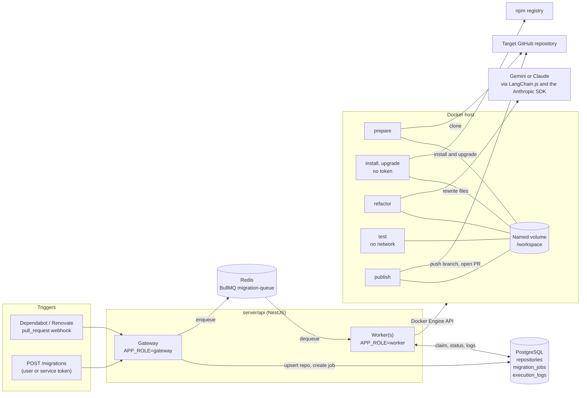
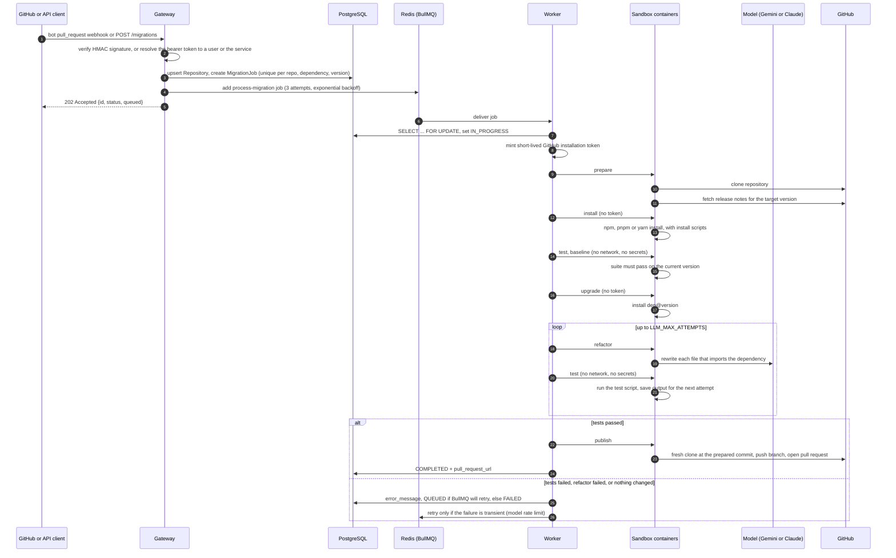
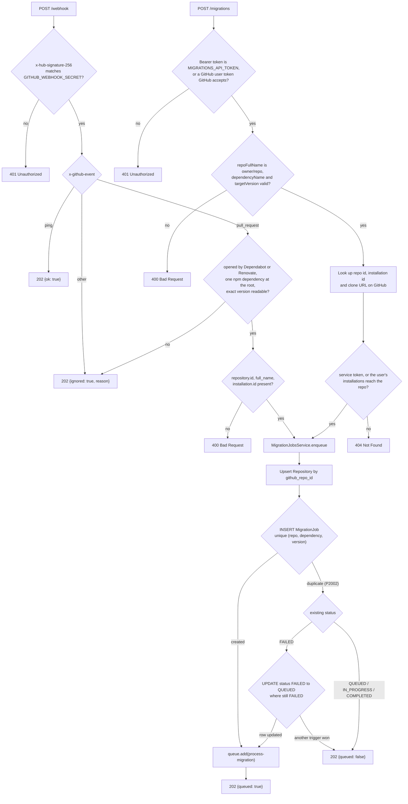
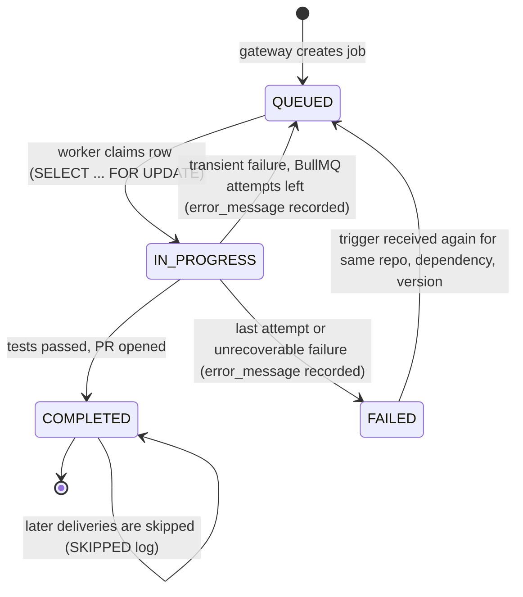
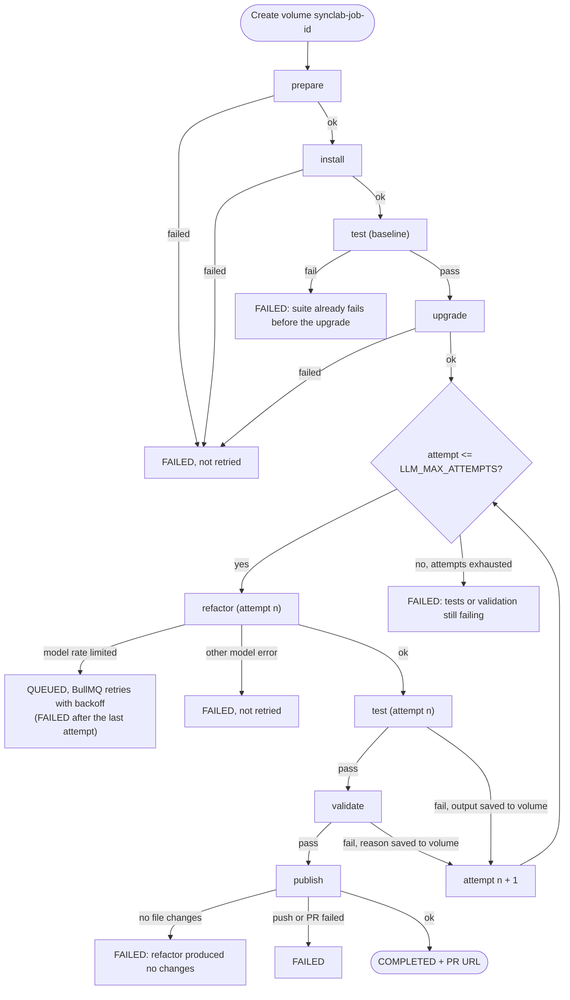
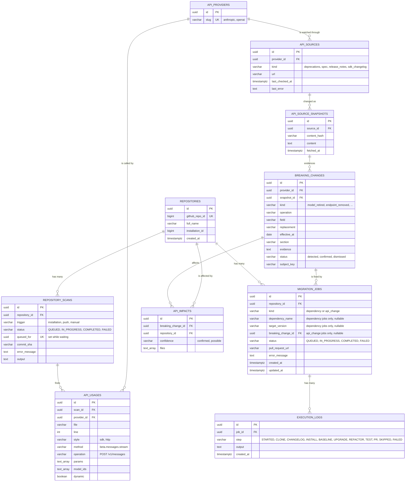

# SyncLab

SyncLab is an autonomous API migration agent.
When a dependency ships a breaking release, SyncLab clones the affected repository, upgrades the dependency, rewrites the code that uses it with an LLM, proves the change with the repository's own test suite, and opens a pull request.
A confirmed breaking change in a watched provider API also queues a migration job for each repository it is confirmed to affect.

The untrusted repository code never runs on the orchestrating server.
Every step that touches it runs in a short-lived, locked-down Docker container, and the only container that executes repository code has no network and no credentials.

A web dashboard in `web/` shows every migration job, its progress through the pipeline, and its execution log.

- [How it works in one minute](#how-it-works-in-one-minute)
- [High-level workflow](#high-level-workflow)
- [Low-level workflow](#low-level-workflow)
- [Dashboard](#dashboard)
- [Data model](#data-model)
- [Failure handling and retries](#failure-handling-and-retries)
- [Repository layout](#repository-layout)
- [Getting started](#getting-started)
- [Testing and benchmarks](#testing-and-benchmarks)
- [Current limitations and roadmap](#current-limitations-and-roadmap)

## How it works in one minute

1. A trigger arrives: a signed `pull_request` webhook for a Dependabot or Renovate npm update, or an authenticated `POST /migrations` request.
2. The **gateway** records a `MigrationJob` in PostgreSQL and enqueues it on a BullMQ queue in Redis.
3. A **worker** claims the job and, for a dependency migration, runs the **sandbox** image as a sequence of containers over one shared Docker volume:
   `prepare` (clone, fetch release notes), `install`, a baseline `test` on the current version, `upgrade`, then `refactor` and `test` in a loop, then `publish`.
4. If the tests pass, `publish` pushes a branch and opens a pull request, and the job is marked `COMPLETED` with the PR URL.

A confirmed breaking change queues a job on its own, whenever impacts are recomputed.
Each affected repository gets one `api_change` job, and only when the impact's confidence is `confirmed` and the change itself is `confirmed`.
`behavior_changed` is recorded and never queued.
The job points at the breaking change, stores no dependency name or version, and is left untouched if one already exists for that repository and change, including a job that `FAILED`.
Sooner effective dates run first.
A change with no effective date runs last among API-change jobs, and dependency jobs have no queue priority, so they run before any of them.
The worker always skips `upgrade` for an API-change job.
If the queue rejects the job, that job is marked `FAILED` with the queue error.

## High-level workflow

### System architecture



The gateway and worker are the same NestJS application started in different roles.
`APP_ROLE=all` (the default) runs both in one process.
Running one gateway and several `APP_ROLE=worker` processes lets jobs run in parallel, because every worker pulls from the same Redis queue.

### End-to-end sequence



## Low-level workflow

### 1. Gateway intake

Code: `server/api/src/gateway/`.



Key details:

- Signatures are checked over the raw request body with a constant-time comparison, so a forged or re-serialized payload is rejected.
- Deduplication relies on the database unique constraint rather than read-then-write, so two concurrent deliveries of the same update cannot both create a job.
- The webhook reads the dependency and exact version from the bot's pull request title (Renovate's shortened `to v5` from the change table in its body), and ignores grouped updates, other ecosystems, subdirectories, forks and anything not authored by the bot account.
  See [`server/api/README.md`](server/api/README.md#automatic-trigger-dependabot-and-renovate-pull-requests).
- A user's bearer token is resolved through GitHub to the repositories their installations reach, and every read and write is limited to those repositories by GitHub repository id.
- A redelivered webhook never opens a second pull request, but a job that previously `FAILED` is queued again.
  The conditional `FAILED` to `QUEUED` update is the claim on that retry, so concurrent triggers queue it only once.
- Both triggers share `MigrationJobsService`, so they deduplicate and retry identically.

### 2. Worker job lifecycle

Code: `server/api/src/worker/migration.processor.ts` and `claim-job.ts`.



For each job the worker:

1. Locks the `migration_jobs` row in a transaction.
   If the job is already `COMPLETED`, it writes a `SKIPPED` log and stops; otherwise it sets `IN_PROGRESS`.
2. Mints a GitHub App installation token (or falls back to `GITHUB_TOKEN` for local development).
   The App private key never leaves the worker.
3. With a hosted `LLM_PROVIDER`, refuses to start without its key (`GEMINI_API_KEY` or `ANTHROPIC_API_KEY`, unrecoverable).
4. Checks the sandbox image exists locally, creates a named volume `synclab-job-<jobId>`, and runs the phases below.
5. Appends every phase's step logs to `execution_logs`, then removes every container and the volume, whatever the outcome.

### 3. Sandbox phase loop

Code: `server/api/src/worker/sandbox/docker-sandbox.service.ts` (orchestration) and `server/sandbox/src/phases/` (what runs inside each container).



The phases above are a dependency job.
An `api_change` job skips `upgrade`, and a failing baseline says the suite already fails before the migration.

Each phase is a fresh container from the same `synclab-sandbox` image, started with the phase name as its command.
State passes between phases only through the shared `/workspace` volume: the repository checkout in `/workspace/repo` and small state files in `/workspace/state` (release notes, the last test output, and the last validation failure).

#### Phase isolation

The same image also runs the phases of a repository scan (`clone`, then `scan`) and the change monitor's `classify`, so the table covers them too.

| Phase | Network | GitHub token | Model access | Runs repository code |
| --- | --- | --- | --- | --- |
| `prepare` | yes | yes | no | no |
| `install` | yes | **no** | no | **yes** (dependency install scripts) |
| `upgrade` | yes | **no** | no | **yes** (the new release's install scripts) |
| `refactor` | yes | no | yes | no |
| `test` | **none** | no | no | **yes** (the test suite, baseline and each attempt) |
| `validate` | **none** | no | no | no (only SyncLab's checks) |
| `publish` | yes | yes | no | no |
| `clone` | yes | yes | no | no |
| `scan` | **none** | no | no | no (only parses the checkout) |
| `classify` | yes | no | yes | no (gets only the text to classify) |

The token is only ever present in the phases that clone or push and run nothing but SyncLab's own code.
Repository code can still write to the checkout on the volume, including its `.git` directory, so `publish` never runs git there: a planted hook, `core.fsmonitor` command or filter driver would otherwise run beside the token.

Every container also runs as the non-root `node` user, with all Linux capabilities dropped, `no-new-privileges`, a hard memory ceiling with swap disabled, a CPU quota, a PID limit, and a per-phase timeout.
The workspace is a named Docker volume, never a bind mount of the host filesystem.
These rules live in `server/api/src/worker/sandbox/container-options.ts`.

#### `prepare`

1. Writes the token to a git credential file in the container's home (never into the remote URL or the volume), then clones the repository (full clone, since GitHub rejects pushes from some shallow clones).
2. When the job names a dependency, resolves that package's GitHub repository from the npm registry and fetches the release notes for the target tag (`1.2.3` or `v1.2.3`).
   This is best effort; a migration without notes still runs.
   An API change that keeps its SDK does not fetch notes.
3. Reports the cloned commit, which the worker later hands to `publish`.

#### `install`

Installs dependencies with their lifecycle scripts, so packages that need a native build step work.
The package manager comes from the `packageManager` field in `package.json`, otherwise from the lockfile (`pnpm-lock.yaml`, `yarn.lock`, `package-lock.json`), otherwise npm (`server/sandbox/src/package-manager.ts`).
A lockfile is honoured exactly (`npm ci`, `pnpm install --frozen-lockfile`, `yarn install --frozen-lockfile` or `--immutable` for Yarn 2+).
pnpm and yarn run through corepack, at the version `packageManager` pins.
Corepack's downloads and Yarn 2+'s package cache live on the volume, because the test phase has no network to fetch them again.

#### Baseline `test`

Runs the test suite once on the version the repository already had.
If it fails, the job fails straight away: the suite cannot verify a migration, and every refactor attempt would be spent on a failure the model did not cause.

#### `upgrade`

Upgrades the migrated dependency with the detected package manager (`server/sandbox/src/upgrade.ts`).
- The exact target version is requested, so the suite runs against that version and not the newest one a range would allow.
- The package stays in the `package.json` section it was declared in, and an exact pin stays exact; a leading `v` in the version is stripped.
  npm and pnpm save a range as `^<version>`; yarn saves what it is asked for, so with yarn a range becomes an exact pin.
- If the package is not a direct dependency, or the version does not exist, the phase fails.
- The new release's install scripts run, since this phase has no token.

#### `refactor`

1. For a dependency job, walks the repository's `.ts`, `.tsx`, `.mts`, `.cts`, `.js`, `.jsx`, `.mjs` and `.cjs` files, skipping `node_modules`, `dist`, `build` and similar directories.
2. Parses each file with Babel and keeps only the files that `import` or `require` the dependency (including deep imports such as `pkg/sub`), recording the imported names and the lines that use them.
   An API-change job sends the files from its impact record instead of this import scan.
   Its prompt is the migration brief in [Self-Maintaining API](infra/Architecture/05%20-%20Self-Maintaining%20API.md#migration-and-validation).
3. Caps the work at `LLM_MAX_FILES` files of at most `LLM_MAX_FILE_BYTES` each, and reports anything it skipped.
4. Sends each candidate file to the configured model (`LLM_PROVIDER`, Gemini by default).
   Gemini answers with structured output `{changed, contents, reason}`.
   Claude answers with a one-sentence reason followed by the file in a fenced block over a streamed request, so the file needs no JSON escaping and a reply cut off at `max_tokens` is caught from the stop reason.
   A Claude refusal is retried server-side on Anthropic's default fallback model before the file is failed.
   For a dependency job, the prompt includes the dependency, target version, release notes, and the imported names and usage lines.
   On a retry, the prompt also includes the previous failing test output, or the validation failure when the suite passed and a check did not.
   The model returns the complete file rather than a diff, because diffs fail to apply too often.
5. Writes back only files the model actually changed.

#### `test`

Runs the package manager's `test` script in the checkout with no network and no credentials, and saves the full output to the volume so the next `refactor` attempt can correct itself.
A failing run also drops any validation failure left by the previous attempt, since this attempt never reached validation.

#### `validate`

Runs after a test attempt passes, and only then, for both dependency jobs and API-change jobs.
It loads every check module in `server/sandbox/src/validate/checks` and passes when none of them reports a problem.
No checks are registered yet, so today it passes.
The worker passes each check the JSON it builds in `server/api/src/worker/sandbox/validation-context/`, and a check adds its own keys in its own file there.
A failed check is written to the volume and the next `refactor` attempt reads it.
The container has no network and no token, so a check cannot call a provider.

#### `publish`

1. Checks `REPO_FULL_NAME` is exactly `owner/repo` before doing anything else, and refuses to publish unless the checkout is a real directory directly inside the workspace, not a symlink, before any credentials are written.
2. Clones the repository afresh into the container's own temporary directory and checks out the worker's branch at the commit `prepare` cloned, so the branch is based on what was tested even if the default branch has moved.
   A dependency job uses `synclab/<dependency>-<version>`.
   An API-change job uses `synclab/api-<provider>-<subject>-<eight characters of the change id>`, where the subject is a slug of the changed field, operation, or kind.
3. Copies the working tree from the volume onto that clone, skipping `.git` and `node_modules`, and removes tracked files the earlier phases deleted.
   Symlinks are recreated, never followed, and a write that would resolve outside the clone is refused.
4. If nothing changed, reports `skipped` and the worker fails the job with `refactor produced no changes`.
5. Otherwise commits everything with hooks disabled, and force-pushes the branch so a retried job reuses it.
   The commit subject and pull request title are a single line of at most 120 characters.
   A dependency upgrade includes the `package.json` and lockfile bump in that commit.
   An API-change commit and pull request are titled as described in [Self-Maintaining API](infra/Architecture/05%20-%20Self-Maintaining%20API.md#migration-and-validation).
6. Opens a pull request against the repository's default branch, or returns the already open one for that branch.

#### Phase result protocol

Each container prints one final line, `##SYNCLAB_RESULT##{json}`, describing `{phase, ok, error, steps, data}`.
The worker scans the logs from the end, so repository output that happens to contain the sentinel cannot shadow the real result.
If no result line appears (for example, the container was killed), the raw log becomes the failure record.

## Dashboard

`web/` is a Next.js app for watching migrations (Tailwind CSS, shadcn/ui, Magic UI and Aceternity UI components, light and dark themes).

| Route | Shows |
| --- | --- |
| `/` | The landing page, including for a signed-in visitor. Old dashboard filter links (`/?status`, `/?repo`, `/?q`) redirect to `/dashboard` |
| `/dashboard` | Job counts per status that double as filters, the jobs running now, and a searchable job table |
| `/jobs/[id]` | One job's pipeline track, failure reason, and execution log. The stages, how an API-change job is titled, and which jobs can be retried are in [`web/README.md`](web/README.md#pages) |
| `/repositories` | Every repository the signed-in user's installations reach, with job totals and last activity |
| `/api-changes` | The API change monitor's watched Anthropic and OpenAI sources and the breaking changes it found, with a button to check every source now |
| `/migrations/new` | A form to pick a repository, one of its dependencies, and a target version, which starts a job through `POST /migrations` |
| `/settings` | GitHub sign-in, and the App installations the signed-in user can access (or an Install SyncLab button when there are none) |

Signed in, every page reads the API with the user's own GitHub token (`GET /migrations`, `/migrations/counts`, `/migrations/:id`, `/repositories`), and the API limits each answer to that user's repositories.
Signed out, the pages show sample data shaped like the API's answers, with a prompt to sign in.
See [`web/README.md`](web/README.md) for the environment variables that enable sign-in.

## Data model

Schema: `server/api/prisma/schema.prisma`.



A dependency job is unique on `(repository_id, dependency_name, target_version)`, which is what makes those triggers idempotent.
An `api_change` job is unique on `(repository_id, breaking_change_id)` and points at the change, because impact rows are replaced on every recompute.
Deleting a breaking change deletes its jobs.
A check in `server/api/prisma/migrations/20261021000000_api_change_jobs/migration.sql` requires a dependency job to have both dependency fields and no breaking change, and an API-change job to have a breaking change and neither dependency field.
`execution_logs` is append-only and cascades on job deletion.
`repository_scans.queued_for` holds the repository id only while a scan waits to start, so its unique index allows one waiting scan per repository.
`api_usages` cascades on scan deletion, and a repository's current usage is that of its newest completed scan.
Only the newest completed scan of a repository keeps its `api_usages`; completing a scan deletes those of older completed scans, while the `repository_scans` rows stay as history.
`api_source_snapshots` gets a row only when a source's extracted text changes, and `breaking_changes` is unique on `(provider_id, kind, subject_key)`, so reading the same retirement again updates it instead of adding one.
`api_impacts` is unique on `(breaking_change_id, repository_id)` and holds the files a confirmed change affects in that repository.

## Failure handling and retries

BullMQ is configured with 3 attempts and exponential backoff starting at 2 minutes.
Only failures that could succeed on a later try are retried; everything else is thrown as an `UnrecoverableError` so a doomed migration does not spend the model quota three times.

| Failure | Job status | Retried by BullMQ |
| --- | --- | --- |
| Gemini or Anthropic rate limit (429, quota or resource exhausted) | `QUEUED` while retrying, then `FAILED` | yes |
| Anthropic API overloaded (529) | `QUEUED` while retrying, then `FAILED` | yes |
| Model provider not reachable (connection refused, reset or timed out) | `QUEUED` while retrying, then `FAILED` | yes |
| Other model errors (bad key, unknown model, malformed output) | `FAILED` | no |
| `GEMINI_API_KEY` or `ANTHROPIC_API_KEY` missing for the selected provider | `FAILED` | no |
| Clone, install or dependency upgrade failed | `FAILED` | no |
| Test suite already fails before the upgrade (a dependency job) or before the migration (an API-change job) | `FAILED` | no |
| Tests still failing after `LLM_MAX_ATTEMPTS` | `FAILED` | no |
| Refactor produced no changes | `FAILED` | no |
| Infrastructure errors (Docker, GitHub token, database) | `QUEUED` while retrying, then `FAILED` | yes |
| Already `COMPLETED` when claimed | unchanged | no (logged as `SKIPPED`) |

A failed dependency job can also be retried by triggering the same repository, dependency and version again.
The **Retry migration** button on that job's page does exactly that, through `POST /migrations`.
An API-change job stays as it is once it exists, including when it has `FAILED`.

## Repository layout

```text
SyncLab/
├── infra/Architecture/        design documents (Obsidian vault, Mermaid and Excalidraw)
├── web/                       Next.js dashboard for jobs, pipeline progress, execution logs, GitHub sign-in and manual migrations
├── server/
│   ├── docker-compose.yml     PostgreSQL 15 and Redis 7 for local development
│   ├── api/                   NestJS gateway and worker
│   │   ├── prisma/            schema and migrations
│   │   └── src/
│   │       ├── gateway/       webhook and manual trigger controllers, guards, enqueue service
│   │       ├── worker/        BullMQ processor, job claiming, Docker sandbox orchestration
│   │       ├── github/        GitHub App installation tokens and repository lookup
│   │       ├── config/        environment configuration
│   │       └── prisma/        Prisma client module
│   └── sandbox/               code that runs inside the sandbox containers
│       ├── Dockerfile
│       └── src/
│           ├── phases/        prepare, clone, install, upgrade, refactor, test, publish, scan, classify
│           ├── analysis/      Babel import and usage analysis
│           ├── llm/           Gemini and Claude models, refactor and classify chains, retryable error classification
│           ├── package-manager.ts  npm, pnpm and yarn detection and commands
│           └── upgrade.ts     dependency upgrade used by the upgrade phase
└── benchmarks/                validated migration cases, the sandbox benchmark runner and its results
```

## Getting started

Prerequisites: Node.js 22 or later, Docker, and a Gemini API key (the default provider) or an Anthropic API key.
For real repositories you also need a GitHub App (or a personal access token for local experiments).

```bash
# 1. Datastores
cd server
docker compose up -d

# 2. API: configuration, database, sandbox image
cd api
cp .env.example .env          # fill in GITHUB_WEBHOOK_SECRET, GitHub credentials, MIGRATIONS_API_TOKEN and GEMINI_API_KEY (or ANTHROPIC_API_KEY with LLM_PROVIDER=anthropic)
npm install
npx prisma migrate deploy
npm run sandbox:build         # builds synclab-sandbox:latest from ../sandbox

# 3. Run the gateway and a worker in one process
npm run start:dev
```

Queue a migration by hand:

```bash
curl -X POST http://localhost:3000/migrations \
  -H "Content-Type: application/json" \
  -H "Authorization: Bearer $MIGRATIONS_API_TOKEN" \
  --data '{"repoFullName":"owner/repo","dependencyName":"lodash","targetVersion":"4.17.21"}'
```

To run jobs in parallel, start the gateway once and as many workers as the machine can hold (each sandbox may use 2 GB):

```bash
npm run start:gateway
npm run start:worker
npm run start:worker
```

Run the dashboard alongside the API (it uses port 3001, since the API takes 3000):

```bash
cd web
npm install
npm run dev                   # http://localhost:3001
```

See [`server/api/README.md`](server/api/README.md) for every environment variable, registering the GitHub App, signing a test webhook, and the full script list.

### Choosing a model provider

Two hosted providers are wired in: Gemini (`LLM_PROVIDER=gemini`, the default, with `GEMINI_API_KEY`, `gemini-3.1-pro-preview` by default) and Claude (`LLM_PROVIDER=anthropic` with `ANTHROPIC_API_KEY`, `claude-opus-5-5` by default).
Set `LLM_MODEL` to use another model from the same provider.

## Testing and benchmarks

```bash
cd server/api && npm run typecheck && npm test   # unit tests
cd server/api && npm run test:e2e                # signed webhook, no PostgreSQL or Redis needed
cd server/sandbox && npm test                    # phase and helper tests, no network or Docker
cd web && npm run lint && npm test && npm run build  # dashboard lint, unit tests, typecheck and production build
cd web && npm run test:e2e                       # dashboard in Chromium against the real API; needs Docker
```

`.github/workflows/verify.yml` runs these checks, plus the sandbox image build and a dependency review, on every pull request and on pushes to `main` and `develop`.

`benchmarks/` measures how often the real migration pipeline repairs a project after a breaking release.
It runs 60 validated cases across 33 npm packages through the worker's own sandbox driver and the production sandbox image: install, a baseline test, upgrade, then refactor and test up to 3 attempts.
Every case is proven valid first: its suite passes on the old version, fails after the upgrade alone, and passes with a reference fix.
The model sees only what production gives it, each case runs in a fresh Docker volume, and editing a test counts as a failure.
It calls a live model, so it is not part of CI.

Latest run (2026-10-16 to 2026-10-17), success meaning the project's own test suite passes after the migration:

| Metric | Result |
| --- | --- |
| First-attempt test pass rate | 19/60 (31.7%) |
| Success rate after retries | 46/60 (76.7%) |
| Migration time (upgrade to last test) | mean 50.5s, median 9.0s, 90th percentile 136.5s |
| Failures | 11 `tests_failed`, 3 `no_changes` |

| Difficulty | Cases | First attempt | After retries |
| --- | --- | --- | --- |
| easy | 20 | 10 (50.0%) | 19 (95.0%) |
| medium | 21 | 7 (33.3%) | 13 (61.9%) |
| hard | 19 | 2 (10.5%) | 14 (73.7%) |

The run used Gemini Flash models on the free tier, whose small per-model daily quotas forced a mix: `gemini-3.5-flash-lite` (39), `gemini-3.5-flash` (5), `gemini-3.8-flash` (5), `gemini-3.7-flash` (5), `gemini-2.5-flash` (4), `gemini-3-flash-preview` (2).
The rates are therefore a blend across models, not one model's score, and the worker's default Gemini model (`gemini-3.1-pro-preview`) was not tested because the free tier does not include it.
See [`benchmarks/results/report.md`](benchmarks/results/report.md) for the methodology, per-model, per-category and per-package results, and limitations, and [`benchmarks/README.md`](benchmarks/README.md) to reproduce it.

## Current limitations and roadmap

Known gaps in the current implementation:

- Automatic migrations need Dependabot or Renovate running on the repository; SyncLab does not watch npm itself.
  It opens its own pull request next to the bot's rather than pushing onto the bot's branch.
- Install scripts run without the GitHub token, so dependencies installed from private GitHub repositories or private registries cannot be fetched.
- A repository whose suite already fails is not migrated at all; there is no way yet to accept a known set of failing tests.
- With yarn, an upgraded dependency declared as a range is saved as an exact pin, because yarn cannot install an exact version and record a range in one step.

Next phases from [`infra/Architecture/04 - Phased Rollout.md`](infra/Architecture/04%20-%20Phased%20Rollout.md):

- Metrics for queue depth, sandbox start time and LLM token usage.
- Auto-scaling worker deployment (for example, ECS or EKS).
- Pagination beyond the first 500 jobs in `GET /migrations`.

After that, Phases 5 to 10 make SyncLab self-maintaining for external APIs.
Phase 5 (the API usage registry), Phase 6 (change monitoring), Phase 7 (impact analysis), and the Phase 8 queue and dashboard are built.
The sandbox edits a repository for a confirmed API change.
How that job is prompted and published is in [`infra/Architecture/05 - Self-Maintaining API.md`](infra/Architecture/05%20-%20Self-Maintaining%20API.md).
Detecting when the change needs a newer SDK, and Phases 9 and 10, are not built yet.
