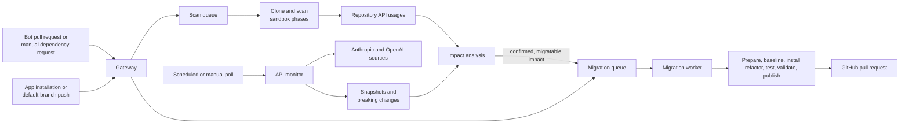

# 00 - Architecture Overview

SyncLab has two paths into one migration pipeline.
A Dependabot or Renovate pull request, or a manual request, starts a dependency migration.
Repository scans and provider monitoring find breaking Anthropic and OpenAI API changes and start API-change migrations for confirmed impacts.
The detailed API-change design is in [[05 - Self-Maintaining API]].

## Current workflow

The gateway verifies webhook signatures, writes jobs and scans to PostgreSQL, and queues work in Redis through BullMQ.
The monitor stores a new snapshot only when the extracted provider content changes.
Spec and deprecation-table changes are confirmed automatically; release-note and SDK-changelog classifications need an admin to confirm them.
Impact analysis joins confirmed changes to usages from the latest completed scan of each repository.
Possible impacts and `behavior_changed` findings are reported without starting a migration.

Dependency jobs run `upgrade` after the baseline test.
API-change jobs target files from the impact record, run `upgrade` only when a required SDK release is recorded, and validate the migrated API usage before publishing.
Both paths use short-lived, phase-specific Docker containers over one named volume, with logs and status stored in PostgreSQL.
See [[01 - Core Components]], [[02 - Database & Queue]], and [[03 - Security & Isolation]] for the implementation boundaries.

## Self-maintenance boundary

The external API-change path is implemented through scanning, monitoring, impact analysis, migration, rescan, OpenAI schema checks, and SDK typechecks when a required release is recorded.
Phase 10's progress is in [[04 - Phased Rollout]].
