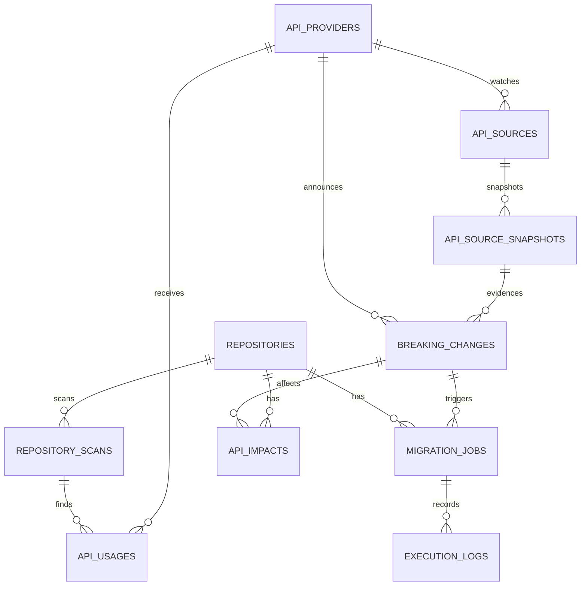

# 02 - Database & Queue

PostgreSQL is the source of truth for migration jobs, scans, provider changes, impacts, and execution logs.
Redis and BullMQ deliver work to the scan, API-monitor, and migration workers.
The canonical schema is `server/api/prisma/schema.prisma`; this note shows the relationships and queue rules rather than copying its SQL.

## Data relationships

A `MigrationJob` has kind `dependency` or `api_change`.
Dependency jobs have a package name and target version; API-change jobs point to a `BreakingChange` and name an SDK package and minimum version only when the change requires one.
The API-change job points to the change rather than an `ApiImpact`, because impact rows are rebuilt after each scan or confirmation.
An `ApiUsage` belongs to a `RepositoryScan`, and only the newest completed scan of a repository retains usages.
The monitor stores a new `ApiSourceSnapshot` when extracted content changes and records the breaking changes supported by that snapshot.
See [[05 - Self-Maintaining API#Data model]] for the API-specific fields.

## Queues and idempotency

- The migration queue accepts dependency jobs from the gateway and API-change jobs from confirmed impacts.
  A database uniqueness constraint allows one dependency job per repository, package, and version, and one API-change job per repository and breaking change.
- A failed dependency job can be queued again by the same trigger.
  An API-change job is not recreated after it exists, even when it failed.
- The scan queue has at most one waiting scan per repository.
  A later push or manual request can start a new scan after the waiting scan begins.
- The API-monitor queue has one recurring scheduler and accepts a deduplicated manual poll.
  A worker polls sources one at a time.
- Dependency jobs have no BullMQ priority and run before prioritized API-change jobs.
  Among API-change jobs, earlier effective dates run first and changes without a date run last.

The worker claims each migration row under a database lock before running Docker phases.
A completed migration is skipped on later deliveries, and phase logs are append-only.
Transient model failures may retry with BullMQ backoff; unrecoverable failures stay `FAILED`.
If queueing a newly created API-change job fails, the database row is marked `FAILED` so it does not remain stuck as `QUEUED`.
