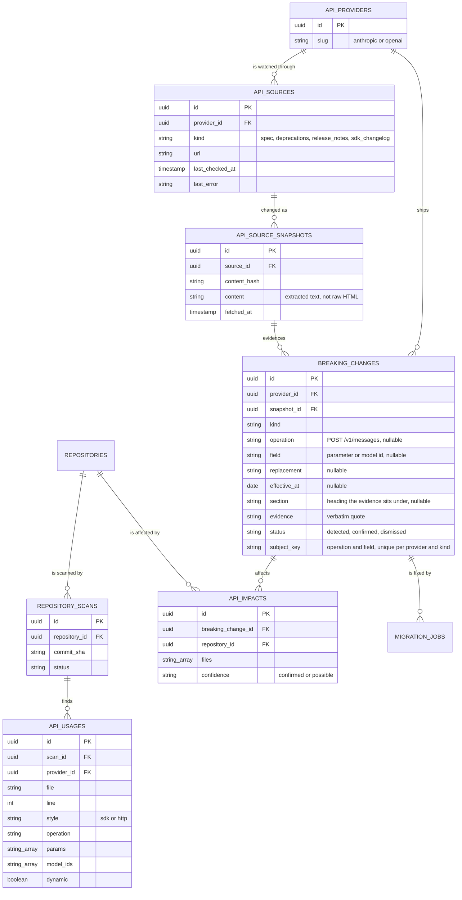

# 05 - Self-Maintaining API

SyncLab today reacts to a dependency release: Dependabot or Renovate opens a pull request, and SyncLab migrates the code that uses the package.
This extension makes SyncLab react to the API itself.
When an external API provider ships a breaking change, SyncLab finds every connected repository that calls the affected part of the API, migrates the calls, proves the result, and opens a pull request.
The rollout is Phases 5 to 10 in [[04 - Phased Rollout]].

![[Self-Maintaining API Workflow.excalidraw]]

## Scope

- Two providers: Anthropic and OpenAI.
  SyncLab itself calls Anthropic, so SyncLab can maintain its own repository (see Phase 10).
  OpenAI is the other major provider, and it publishes an OpenAPI spec, which exercises the spec-diff path that Anthropic cannot.
- JavaScript and TypeScript repositories, because the scanner reuses the Babel analysis SyncLab already has.
- Three usage styles: the official SDKs (`@anthropic-ai/sdk`, `openai`), raw HTTP calls (`fetch` or `axios` to `api.anthropic.com` or `api.openai.com`), and model IDs.
- Wrappers such as `@langchain/openai` or the Vercel AI SDK are out of scope at first.

## Why this is different from a dependency migration

Many breaking API changes arrive without any SDK release that a bot would open a pull request for.
A model is retired on a date, a parameter starts returning a 400 on newer models, an endpoint is replaced by a new one.
The SDK version in `package.json` can stay the same while the code stops working.
So the trigger has to come from watching the provider, not from watching npm.

## Change sources

| Source | Anthropic | OpenAI | How it is read |
| --- | --- | --- | --- |
| OpenAPI spec | none published | `openai/openai-openapi` (`openapi.yaml`) | Deterministic diff with breaking-change rules |
| Model deprecations | `platform.claude.com/docs/en/about-claude/model-deprecations` | `platform.openai.com/docs/deprecations` | Table rows parsed into retirements with dates |
| API release notes | `platform.claude.com/docs/en/release-notes/api` | `platform.openai.com/docs/changelog` | LLM classifier with structured output |
| SDK changelog | `anthropic-sdk-typescript` `CHANGELOG.md` | `openai-node` `CHANGELOG.md` | LLM classifier with structured output |

Anthropic does not publish an OpenAPI spec, so its changes come from the deprecations page and the changelogs only.
A later improvement is to diff the type declarations of two `@anthropic-ai/sdk` releases, which carry the request parameters and model ID unions.

The monitor stores every fetched source as a snapshot with a content hash, and only a changed hash is processed.
The hash covers what each reader parses, not the raw page: the tables of a deprecations page, the request surface of the spec (one line per operation and per request parameter, with its required flag and enum values), and the text of release notes and changelogs, one line per heading, paragraph or list item.
Markup that changes on every request therefore does not count as a change.
Each source is requested in exactly that format, because the docs sites answer a request that also accepts markdown with markdown.
The spec, release notes and changelogs are compared with their previous snapshot, so a source's first snapshot is a baseline and history is not reported as new.
When most of a release notes page is new at once, its markup or the extraction changed rather than the notes, so it becomes a new baseline without being classified.
Release notes and changelogs are classified in a `classify` sandbox phase with the configured hosted model (`gemini` or `anthropic`), given only the lines added since the previous snapshot; it runs no repository code and holds no GitHub token.
Each watched page is an `ApiSource` row that also records when it was last checked and its last error, which the dashboard shows as the source's freshness.
A classifier result must quote its evidence, and the quote must appear verbatim in the snapshot, or the result is dropped.
That keeps an LLM from inventing a breaking change.

## Breaking change kinds

| Kind | Example | Auto-migratable |
| --- | --- | --- |
| `model_retired` | A model ID stops being served on a date | yes |
| `param_removed` | A request parameter is rejected | yes |
| `param_renamed` | A parameter moves to a new name or nesting | yes |
| `param_now_required` | A request needs a parameter it did not before | yes |
| `enum_value_removed` | An accepted value of a parameter is gone | yes |
| `endpoint_removed` | An endpoint is replaced by another | yes, when a replacement is named |
| `behavior_changed` | Same request, different response semantics | no, reported only |

Changes from the spec diff and the deprecation tables are confirmed automatically.
Changes from a release-note or changelog classification start as `detected` and need a confirm from the API or the dashboard, unless a provider is configured to trust them.

## Repository scanning

A new sandbox phase, `scan`, runs on the volume after `prepare` has cloned the repository.
It only parses files, so like `refactor` it never executes repository code, and it needs neither the GitHub token nor a network.

The scanner extends `server/sandbox/src/analysis/imports.ts`:

1. Finds imports and requires of the supported SDKs, and follows the client to its method calls.
   It follows the client across modules, including through local factory functions that return a constructed SDK client.
   For example SyncLab's `createAnthropicClient()` in `server/sandbox/src/llm/model.ts` returns the client that `refactor-chain.ts` calls, and `refactor-chain.ts` never imports `@anthropic-ai/sdk` itself.
2. Maps a method chain to an API operation with a small table per SDK.
   The table covers beta namespaces and streaming variants as well as the plain method.
   For example `client.messages.create`, `client.messages.stream`, and `client.beta.messages.stream` are all `POST /v1/messages`, and `client.chat.completions.create` is `POST /v1/chat/completions`.
3. Records the keys of a literal request object and any literal model ID.
   A value it cannot resolve statically, such as a model read from configuration, is recorded as dynamic.
4. Finds raw HTTP calls whose URL is a literal or template string on a provider host.
   Those calls record query parameter names from the URL and header names from the request on `params`, together with the body keys.
5. Ignores mentions in strings and comments, the same way the dependency analysis does.

## Data model



An API-change migration is a `migration_jobs` row that points at `breaking_change_id`, not at an impact.
Impact rows are deleted and recreated on every recompute, so an impact id is not a stable target.
The columns and the unique key per repository and change are in `server/api/prisma/schema.prisma`.
The check that separates a dependency job from an API-change job is in `server/api/prisma/migrations/20261021000000_api_change_jobs/migration.sql`.

## Monitoring endpoints

The dashboard reads the monitor through these endpoints, and both sides build against the shapes below.
All of them take the same bearer token as the rest of the API: a signed-in user's GitHub token or `MIGRATIONS_API_TOKEN`.
Breaking changes are not tied to a repository, so any authenticated caller can read them.
Confirming or dismissing one changes what every installation sees, so only an admin may: the `MIGRATIONS_API_TOKEN` service caller, or a user whose GitHub login is listed in `MONITOR_ADMIN_LOGINS` (comma-separated, case-insensitive; empty or unset means no user is an admin).
Any other user gets `403`.
Timestamps are ISO 8601 strings; `effectiveAt` is a calendar date (`YYYY-MM-DD`).

| Endpoint | Phase | Returns |
| --- | --- | --- |
| `GET /api-providers` | 6a | every provider with its watched sources and change counts |
| `POST /api-providers/poll` | 6a | `202 {"queued": true}`; fetches every source now instead of waiting for the schedule |
| `GET /api-changes` | 6a | breaking changes, newest first, filterable with `?provider=`, `?status=` and `?kind=` |
| `POST /api-changes/:id/confirm` | 6b | the updated change, with `status: "confirmed"`; admins only |
| `POST /api-changes/:id/dismiss` | 6b | the updated change, with `status: "dismissed"`; admins only |
| `GET /api-changes/:id/impact` | 7 | the repositories and files the change affects |

`GET /api-providers`:

```json
[
  {
    "slug": "anthropic",
    "sources": [
      {
        "kind": "deprecations",
        "url": "https://platform.claude.com/docs/en/about-claude/model-deprecations",
        "lastCheckedAt": "2026-10-17T06:00:00.000Z",
        "lastError": null,
        "latestSnapshot": {
          "id": "6f1c...",
          "contentHash": "9b2e...",
          "fetchedAt": "2026-10-01T14:35:59.000Z"
        }
      }
    ],
    "changeCounts": { "detected": 0, "confirmed": 21, "dismissed": 0 }
  }
]
```

`lastCheckedAt` is the last fetch, successful or not; `lastError` is the last fetch's error, or the error from recording impact after that snapshot was stored, or `null`; `latestSnapshot` is the last fetch whose content changed, or `null` before the first one.
Sources are of kind `deprecations`, `spec` (OpenAI's OpenAPI spec), `release_notes` and `sdk_changelog`.

`GET /api-changes`:

```json
[
  {
    "id": "0d4a...",
    "provider": "anthropic",
    "kind": "model_retired",
    "operation": null,
    "field": "claude-sonnet-4-5-20250929",
    "replacement": "claude-sonnet-5-5",
    "effectiveAt": "2026-11-30",
    "section": "2026-09-30: Claude Sonnet 4.5 model",
    "evidence": "November 30, 2026 | claude-sonnet-4-5-20250929 | claude-sonnet-5-5",
    "status": "confirmed",
    "source": {
      "kind": "deprecations",
      "url": "https://platform.claude.com/docs/en/about-claude/model-deprecations"
    },
    "snapshotId": "6f1c...",
    "detectedAt": "2026-10-01T14:36:02.000Z",
    "updatedAt": "2026-10-01T14:36:02.000Z",
    "canReview": false
  }
]
```

`kind` is one of the kinds in the table above and `status` is `detected`, `confirmed` or `dismissed`.
`operation`, `field`, `replacement`, `effectiveAt` and `section` are `null` when they do not apply.
`evidence` is the verbatim line of the snapshot the change was read from, and `section` is the heading it sits under.
A removal read from the spec diff (`endpoint_removed`, `param_removed` or `enum_value_removed`) is the exception: the removed line is no longer in the linked snapshot, so `evidence` is the verbatim line of the previous snapshot's surface, the snapshot before the one `snapshotId` names.
`canReview` is `true` when the caller may confirm or dismiss the change, so the dashboard can hide those actions from everyone else; the confirm and dismiss responses always carry `true`.
A model retirement names the model in `field`; an endpoint removal from a deprecations page names the path in `operation`, such as `/v1/edits`, because those pages do not give the HTTP method, while one from the spec diff carries it, such as `POST /v1/agents/sessions`.
A parameter change names the parameter in `field`, and a removed enum value is written `parameter=value`.
The spec diff only reads top-level request parameters; a change inside a nested object is not reported.

## Impact analysis

Impact is a deterministic join, not a model call.
A breaking change matches a usage on provider, operation, and the changed parameter or model ID.
A usage is `possible` rather than `confirmed` when the call's operation or the changed value is only known at runtime, and only `confirmed` impacts start a migration on their own.
A literal model id is `confirmed` for that model even when a header or query string on the call is dynamic, and a different model id does not match it.
A removed or renamed parameter that names no operation stays `possible` when the call sends the name.
A newly required parameter that names no operation matches nothing.
A newly required parameter matches calls of that operation which do not already send it.
Parameter names are compared without regard to case.
An enum value is not stored on a usage, so removing one is `possible` when the parameter is present.
An endpoint retirement named as a bare path, such as `/v1/edits`, matches a usage whose operation ends with that path.
A behavior change matches every usage of its operation, matches nothing when it names no operation, and is reported here without a migration.
Impact is recomputed when a repository is scanned, when a change is confirmed, and when the monitor stores an already-confirmed spec or deprecation change.
If the monitor's recompute fails after the snapshot is stored, the source keeps the error and the next poll retries it, including when the page has not changed.
Dismissing a change removes its impacts.
A worker recomputes every confirmed change when it starts, so impacts exist before the next scan or confirmation.
Changes with an effective date are migrated in date order, so a retirement is fixed before it lands.
That ordering is part of running the migration, in Phase 8.

`GET /api-changes/:id/impact` returns:

```json
{
  "changeId": "0d4a...",
  "impacts": [
    {
      "repositoryId": "1b2c...",
      "githubRepoId": "42",
      "fullName": "acme/api",
      "confidence": "confirmed",
      "files": ["src/chat.ts"]
    }
  ]
}
```

A user receives only repositories their installations reach.
The service caller receives every recorded repository.
An unknown change is `404`.

## Migration and validation

The migration reuses the existing pipeline: AST targeting, `refactor` with the configured `LLM_PROVIDER`, the repository's own test suite, the retry loop that feeds failures back, and `publish`.
Two things change.
The prompt gets a migration brief (the change kind, before and after, the evidence quote and its source URL) instead of package release notes.
Files come from the impact record instead of from the dependency's imports.

The worker tells the sandbox phases which kind of job they are running through these environment variables:

| Variable | Meaning |
| --- | --- |
| `MIGRATION_KIND` | `dependency` (the default) or `api_change`. |
| `API_CHANGE` | The brief as JSON: `provider`, `kind`, `operation`, `field`, `replacement`, `effectiveAt` (`YYYY-MM-DD`), `evidence` and `sourceUrl`. The optional fields may be null. `behavior_changed` is refused, since it is reported and never migrated. |
| `TARGET_FILES` | The impact's files as a JSON array of repository-relative paths. |
| `DEPENDENCY_NAME`, `TARGET_VERSION` | Required for a dependency job. For an API change they are set together, only when the change needs a newer SDK, and the worker then runs `upgrade`. |
| `BRANCH_NAME` | `synclab/api-<provider>-<change>` for an API change. |

`refactor` sends only the listed files that are regular files inside the checkout, so a link planted by repository code is skipped rather than followed.
`publish` titles the pull request after the change and puts the source and deadline in its body.

Passing tests is necessary but not enough, because a test suite rarely calls the real API.
So a migration is also validated before `publish`:

1. The scanner runs again on the migrated tree, and the impacted usage must be gone with no new use of anything retired or removed.
2. For OpenAI, literal request objects are checked against the request schema of the new spec.
3. For a TypeScript repository, the typecheck runs against the SDK version the change requires.

A failed check goes back into the retry loop with its reason, like a failing test.
A live call to the provider is deliberately not part of validation.
It would mean running repository code with a network connection and an API key, which breaks the isolation model in [[03 - Security & Isolation]].
