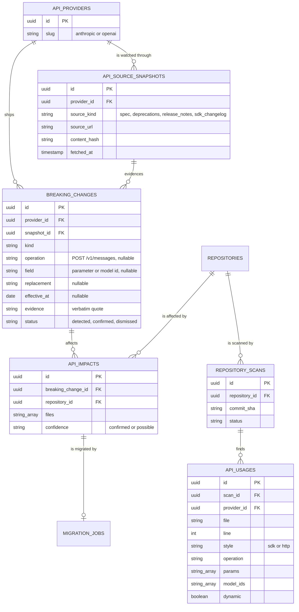

# 05 - Self-Maintaining API

SyncLab today reacts to a dependency release: Dependabot or Renovate opens a pull request, and SyncLab migrates the code that uses the package.
This extension makes SyncLab react to the API itself.
When an external API provider ships a breaking change, SyncLab finds every connected repository that calls the affected part of the API, migrates the calls, proves the result, and opens a pull request.
The rollout is Phases 5 to 10 in [[04 - Phased Rollout]].

![[Self-Maintaining API Workflow.excalidraw]]

## Scope

- Two providers: Anthropic and OpenAI.
  Both are what SyncLab itself calls, so SyncLab can maintain its own repository (see Phase 10).
- JavaScript and TypeScript repositories, because the scanner reuses the Babel analysis SyncLab already has.
- Three usage styles: the official SDKs (`@anthropic-ai/sdk`, `openai`), raw HTTP calls (`fetch` or `axios` to `api.anthropic.com` or `api.openai.com`), and model IDs.
- Wrappers such as `@langchain/openai` or the Vercel AI SDK are out of scope at first.

## Why this is different from a dependency migration

Many breaking API changes arrive without any SDK release that a bot would open a pull request for.
A model is retired on a date, a parameter starts returning a 400 on newer models, an endpoint is replaced by a new one.
The SDK version in `package.json` can stay the same while the code stops working.
So the trigger has to come from watching the provider, not from watching npm.

## Change sources

| Source | Anthropic | OpenAI | How it is read |
| --- | --- | --- | --- |
| OpenAPI spec | none published | `openai/openai-openapi` (`openapi.yaml`) | Deterministic diff with breaking-change rules |
| Model deprecations | `platform.claude.com/docs/en/about-claude/model-deprecations` | `platform.openai.com/docs/deprecations` | Table rows parsed into retirements with dates |
| API release notes | `platform.claude.com/docs/en/release-notes/api` | `platform.openai.com/docs/changelog` | LLM classifier with structured output |
| SDK changelog | `anthropic-sdk-typescript` `CHANGELOG.md` | `openai-node` `CHANGELOG.md` | LLM classifier with structured output |

Anthropic does not publish an OpenAPI spec, so its changes come from the deprecations page and the changelogs only.
A later improvement is to diff the type declarations of two `@anthropic-ai/sdk` releases, which carry the request parameters and model ID unions.

The monitor stores every fetched source as a snapshot with a content hash, and only a changed hash is processed.
A classifier result must quote its evidence, and the quote must appear verbatim in the snapshot, or the result is dropped.
That keeps an LLM from inventing a breaking change.

## Breaking change kinds

| Kind | Example | Auto-migratable |
| --- | --- | --- |
| `model_retired` | A model ID stops being served on a date | yes |
| `param_removed` | A request parameter is rejected | yes |
| `param_renamed` | A parameter moves to a new name or nesting | yes |
| `param_now_required` | A request needs a parameter it did not before | yes |
| `enum_value_removed` | An accepted value of a parameter is gone | yes |
| `endpoint_removed` | An endpoint is replaced by another | yes, when a replacement is named |
| `behavior_changed` | Same request, different response semantics | no, reported only |

Changes from the spec diff and the deprecation tables are confirmed automatically.
Changes from a release-note or changelog classification start as `detected` and need a confirm from the API or the dashboard, unless a provider is configured to trust them.

## Repository scanning

A new sandbox phase, `scan`, runs on the volume after `prepare` has cloned the repository.
It only parses files, so like `refactor` it never executes repository code, and it needs neither the GitHub token nor a network.

The scanner extends `server/sandbox/src/analysis/imports.ts`:

1. Finds imports and requires of the supported SDKs, and follows the client to its method calls.
2. Maps a method chain to an API operation with a small table per SDK.
   For example `client.messages.create` is `POST /v1/messages`, and `client.chat.completions.create` is `POST /v1/chat/completions`.
3. Records the keys of a literal request object and any literal model ID.
   A value it cannot resolve statically, such as a model read from configuration, is recorded as dynamic.
4. Finds raw HTTP calls whose URL is a literal or template string on a provider host.
5. Ignores mentions in strings and comments, the same way the dependency analysis does.

## Data model

`MIGRATION_JOBS` gains a `kind` (`dependency` or `api_change`) and a nullable `api_impact_id`.
`dependency_name` and `target_version` become nullable, and an API-change job is unique per repository and breaking change.

## Impact analysis

Impact is a deterministic join, not a model call.
A breaking change matches a usage on provider, operation, and the changed parameter or model ID.
A usage with a dynamic value that could hold the changed value is recorded as `possible` rather than `confirmed`, and only `confirmed` impacts start a migration on their own.
Impact is recomputed when either side changes: a new scan of a repository, or a newly confirmed change.
Changes with an effective date are migrated in date order, so a retirement is fixed before it lands.

## Migration and validation

The migration reuses the existing pipeline: AST targeting, `refactor` with the configured `LLM_PROVIDER`, the repository's own test suite, the retry loop that feeds failures back, and `publish`.
Two things change.
The prompt gets a migration brief (the change kind, before and after, the evidence quote and its source URL) instead of package release notes.
Files come from the impact record instead of from the dependency's imports.

Passing tests is necessary but not enough, because a test suite rarely calls the real API.
So a migration is also validated before `publish`:

1. The scanner runs again on the migrated tree, and the impacted usage must be gone with no new use of anything retired or removed.
2. For OpenAI, literal request objects are checked against the request schema of the new spec.
3. For a TypeScript repository, the typecheck runs against the SDK version the change requires.

A failed check goes back into the retry loop with its reason, like a failing test.
A live call to the provider is deliberately not part of validation.
It would mean running repository code with a network connection and an API key, which breaks the isolation model in [[03 - Security & Isolation]].
